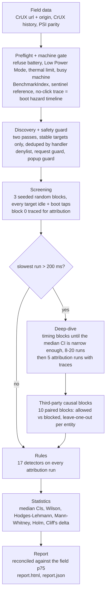

<div align="center">

# inp-analyser

**Find out *why* a page has poor Interaction to Next Paint, not just *that* it does.**

[](https://github.com/franzenzenhofer/inp-analyser/actions/workflows/ci.yml)
[](LICENSE)
[](package.json)
[](skills/inp-analyser/SKILL.md)

[Website](https://franzenzenhofer.github.io/inp-analyser/) · [Quick start](#quick-start) · [Commands](#commands) · [How it works](#how-it-works) · [Agent skill](#agent-skill)

</div>

---

**What you get, for any URL:**

- **The real INP** - the CrUX field p75 that PageSpeed Insights and Search Console show, checked digit for digit against PSI.
- **The issues behind it** - which element, which INP phase, whose script (`URL:line:function`, third-party owner), how many milliseconds.
- **How sure that is** - medians with 95% confidence intervals, reproducibility over many runs, causal proof for third parties.

It diagnoses. It never prints fixes: what to change is your call, made on evidence.

Built for and battle-tested in real-world INP audits of large, ad-heavy sites.

## Contents

- [What is INP?](#what-is-inp)
- [What it finds](#what-it-finds)
- [Install](#install)
- [Quick start](#quick-start)
- [Field data setup](#field-data-setup)
- [Commands](#commands)
- [Example: a real run on Wikipedia](#example-a-real-run-on-wikipedia)
- [Outputs](#outputs)
- [Reading report.json](#reading-reportjson)
- [How it works](#how-it-works)
- [Methodology and statistics](#methodology-and-statistics)
- [Politeness and safety](#politeness-and-safety)
- [Agent skill](#agent-skill)
- [FAQ](#faq)
- [Limitations](#limitations)
- [Contributing](#contributing)
- [License](#license)

## What is INP?

[Interaction to Next Paint](https://web.dev/articles/inp) is the Core Web Vital for responsiveness. For every page visit, the browser measures how long each click, tap and key press takes until the next frame is painted; the page's INP is (close to) the slowest of them. Google reports the 75th percentile over 28 days of real Chrome users:

| INP p75 | Rating |
|---|---|
| <= 200 ms | good |
| 200 - 500 ms | needs improvement |
| > 500 ms | poor |

Every interaction has three phases, and each has different causes ([Optimize INP](https://web.dev/articles/optimize-inp)):

1. **Input delay** - the main thread is busy (often a long task) when the user taps.
2. **Processing duration** - the event handlers themselves run.
3. **Presentation delay** - style, layout, paint and any script that squeezes in before the next frame.

Lighthouse and PSI give you a number. This tool gives you the reasons.

## What it finds

Every issue in the report carries the same set of facts:

| Fact | Example | Where it comes from |
|---|---|---|
| **Element** | `header button.menu-toggle` | Discovered interaction target (CSS selector) |
| **Phase** | `input-delay`, `processing`, `presentation`, `context` | Event Timing phases, split per interaction |
| **Script** | `handleClick (https://example.com/app.js:1:48213) via click` | JS samples in a Chrome trace: function, URL, line, column, invoker |
| **Owner** | `Google Tag Manager (3rd party)` | [third-party-web](https://github.com/patrickhulce/third-party-web) entity map, extendable with `--entity-map` |
| **Milliseconds** | `median 184 ms, 95% CI [161, 210]` | Exact order-statistic CI of the median over the runs where the rule fired |
| **Certainty** | `confirmed`, 9/10 runs, Wilson CI [0.60, 0.98] | Screening vs deep-dive runs, reproducibility interval |

The rules it checks (each links its spec or engine source in the report):

| Phase | Rule IDs |
|---|---|
| Input delay | `input-delay/long-task`, `input-delay/third-party-task`, `input-delay/no-mobile-viewport`, `input-delay/boot-window` |
| Processing | `processing/slow-event-handlers`, `processing/third-party-script`, `processing/forced-reflow`, `processing/layout-thrashing` |
| Presentation | `presentation/large-style-recalc`, `presentation/large-layout`, `presentation/script-before-paint`, `presentation/rendering-dominant`, `presentation/large-dom-change`, `presentation/non-composited-animation` |
| Context | `context/dom-size`, `context/page-exceptions`, `context/off-main-thread-time`, `context/measurement-artifact` |
| Third parties | `third-party/causal-delta`, `third-party/confounded` |

## Install

> Not on npm yet. Install from source.

Requirements: **Node.js >= 26**, git, and roughly 500 MB of disk for the pinned Chrome for Testing build.

```bash
git clone https://github.com/franzenzenhofer/inp-analyser.git
cd inp-analyser
npm ci
npm run chrome:install   # downloads the pinned Chrome for Testing into .chrome/
npm run build
npm link                 # puts `inp` on your PATH
```

Without `npm link`, run the CLI straight from source:

```bash
npx tsx src/cli.ts --help
```

Every measurement runs on one pinned Chrome build, because INP semantics changed across Chrome releases ([INP changelog](https://chromium.googlesource.com/chromium/src/+/main/docs/speed/metrics_changelog/inp.md)). Chrome always runs headless.

## Quick start

```bash
# 1. The real INP, as PSI shows it (no page loads, needs an API key)
inp field https://en.wikipedia.org/wiki/Main_Page

# 2. What the analyser would click, and what it refuses to click
inp discover https://en.wikipedia.org/wiki/Main_Page

# 3. A fast first look: screening runs only
inp analyse https://en.wikipedia.org/wiki/Main_Page --quick

# 4. The full analysis: screening, deep-dive, third-party causal tests
inp analyse https://en.wikipedia.org/wiki/Main_Page --out wiki-main
```

Then open `wiki-main/report.html` in a browser, or read `wiki-main/report.json`.

No API key yet? Add `--no-field` to `analyse` for a lab-only run.

## Field data setup

Field data needs one Google Cloud API key with **both** of these APIs enabled on its project:

- [Chrome UX Report API](https://console.cloud.google.com/apis/library/chromeuxreport.googleapis.com)
- [PageSpeed Insights API](https://console.cloud.google.com/apis/library/pagespeedonline.googleapis.com)

Create the key under [APIs & Services > Credentials](https://console.cloud.google.com/apis/credentials) and set it as `INP_GOOGLE_API_KEY`:

```bash
cp .env.example .env               # .env is git-ignored; put the key in it
set -a && . ./.env && set +a       # or: export INP_GOOGLE_API_KEY=...
```

The CLI reads the environment only; it does not load `.env` by itself. Never commit a real key.

What it fetches per device (phone, desktop):

- CrUX API record for the **URL** and for the **origin**.
- CrUX History API (weekly 28-day periods) for both levels.
- PSI `loadingExperience` / `originLoadingExperience`, compared with CrUX at both levels. Any difference is reported, never averaged away.

The headline is the URL-level p75 when CrUX has it, otherwise the origin-level p75, always labelled with its level, as PSI does.

## Commands

```
inp <command> [options]
```

| Command | What it does |
|---|---|
| `inp field <url>` | CrUX + PSI field INP for phone and desktop. No page loads. Writes `field.json`. |
| `inp discover <url>` | Lists the interaction targets `analyse` would measure (two passes, stable targets only), their safety class, excluded targets with the reason, and global third-party listeners. |
| `inp analyse <url>` | The full pipeline: preflight, discovery, screening, deep-dive, third-party causal tests, diagnosis, report. |
| `inp report <dir>` | Rebuilds `report.json` and `report.html` from a run directory (`runs.jsonl` + `meta.json`). |
| `inp trace <file>` | Issues in an existing DevTools Performance recording (`.json` or `.json.gz`). One recording is one sample: no statistics. |
| `inp compare <before> <after>` | Before/after on two run directories: Hodges-Lehmann shift + 95% CI, Mann-Whitney p (Holm-corrected), Cliff's delta per shared scenario. |
| `inp calibrate` | Measures Lighthouse BenchmarkIndex under each CPU throttling rate on this machine and names the device class each rate reaches. |

### `inp analyse` options

| Option | Default | Meaning |
|---|---|---|
| `--device <mobile\|desktop>` | `mobile` | Mobile emulation with touch, or desktop with mouse |
| `--cpu <rate>` | `4` | CPU throttling rate (Lighthouse default). Pick it with `inp calibrate`. |
| `--quick` | off | Stop after screening (no deep-dive, no causal tests) |
| `--max-targets <n>` | `12` | Interaction targets to measure |
| `--phases <list>` | `boot,idle` | `idle` = tap once the page is loaded and quiet; `boot` = tap while the page is still booting |
| `--budget <minutes>` | `120` | Time budget for all stages; the report says if it ran out |
| `--seed <n>` | random | Seed for the randomised run order (printed in the report, so a run can be repeated) |
| `--out <dir>` | `inp-report-<host>-<timestamp>` | Output directory |
| `--no-field` | field on | Skip CrUX/PSI (lab only, no API key needed) |
| `--entity-map <file>` | none | Extra script owners: `{"entities":[{"name","category","domains"}]}` |
| `--allow-mutations <regex>` | none | First-party non-GET URLs allowed through the request guard |
| `--min-load-interval <seconds>` | `10` | Politeness: minimum seconds between loads of the same origin |
| `--consent-state <file>` | none | Seed an accepted-consent state (cookies + localStorage) into every load; capture one with `scripts/capture-consent-state.ts` |
| `--max-load <n>` | half the cores | Busy-machine limit (1-minute load average) for the start gate |
| `--proxy-server <url>` | none | Chrome proxy for page traffic, e.g. `socks5://localhost:1080` |
| `--host-resolver-rules <rules>` | none | Chrome host resolver rules (for the local test site only) |

Other options: `field --out <dir>`, `discover --device <d> --max-targets <n>`, `trace --entity-map <file>`.

### `inp field` - a real example

Fetched on 11 Nov 2026:

```console
$ inp field https://en.wikipedia.org/wiki/Main_Page
phone  : INP p75 130 ms (url level, 2026-10-12..2026-11-08) good 86.5% / needs improvement 9.7% / poor 3.9% | PSI: equal
desktop: INP p75 61 ms (url level, 2026-10-12..2026-11-08) good 96.8% / needs improvement 2.3% / poor 0.9% | PSI: equal
  - CrUX API: p75 and good/NI/poor shares of real Chrome users over the 28-day collection period 2026-10-12..2026-11-08. https://developer.chrome.com/docs/crux/api
  - CrUX History API: 25 weekly 28-day periods, oldest first; ineligible periods are null. https://developer.chrome.com/docs/crux/history-api
  - PageSpeed Insights loadingExperience/originLoadingExperience (analysed 2026-11-11T05:31:51.750Z / 2026-11-11T05:31:51.501Z): separate source next to CrUX, reports no collection period. https://developers.google.com/speed/docs/insights/rest/v5/pagespeedapi/runpagespeed
  - CrUX PHONE vs PSI mobile, url level: identical (p75 130 ms, same good/NI/poor shares).
  - CrUX PHONE vs PSI mobile, origin level: identical (p75 87 ms, same good/NI/poor shares).
  - CrUX DESKTOP vs PSI desktop, url level: identical (p75 61 ms, same good/NI/poor shares).
  - CrUX DESKTOP vs PSI desktop, origin level: identical (p75 49 ms, same good/NI/poor shares).
[inp] field: inp-report-en.wikipedia.org-202611110531/field.json
```

Read it as: Wikipedia's Main Page has a **good** INP on both devices (phone 130 ms, desktop 61 ms at URL level; the whole origin is at 87 ms and 49 ms), and the CrUX API agrees with PSI to the last digit.

## Example: a real run on Wikipedia

<!-- EXAMPLE-RUN -->

## Outputs

Every `analyse` writes one self-contained run directory:

| File | Contents |
|---|---|
| `report.html` | Human report: field INP, reconciliation, issues with evidence, scenarios, boot hazard timeline, limitations. Self-contained, open it in any browser. |
| `report.json` | Machine-readable result. Both renderers (terminal, HTML) read only this. |
| `runs.jsonl` | One line per measured page load. The single source of truth: every report is rebuilt from it. |
| `meta.json` | Run metadata: URL, seed, Chrome version, condition, targets, excluded targets, scenarios, number of loads. |
| `field.json` | CrUX + CrUX History + PSI data and the parity check (also written by `inp field`). |
| `traces/*.json.gz` | One Chrome trace per attribution run. Drag it into the DevTools **Performance** panel to see exactly what the report describes. |

A terminal summary is printed at the end of every run.

## Reading report.json

The top-level keys you will use most:

| Key | Meaning |
|---|---|
| `field` | The field data (see above). The only number that may be called "INP". |
| `reconciliation` | Does the lab explain the field number? `verdict` + plain-text `text`. |
| `issues[]` | The diagnosed problems, sorted by severity and certainty. |
| `comparisons[]` | Every statistical comparison: boot vs idle, third parties allowed vs blocked. |
| `scenarios[]` | Per target + phase: median, CI, all values, whether it was deep-dived. |
| `targets` | Measured targets, excluded targets (with the reason), global listeners. |
| `run` | Runs, excluded runs, page loads, sentinel reference, `incomplete` if the budget ran out. |
| `limitations` | What this lab run cannot see. Printed in every report. |

### `issues[]` fields

| Field | Meaning |
|---|---|
| `ruleId`, `title` | Which rule fired, e.g. `processing/forced-reflow` |
| `phase` | `input-delay`, `processing`, `presentation` or `context` |
| `severity` | `poor` (> 500 ms), `needs-improvement` (> 200 ms) or `info`, from the scenario's median duration |
| `certainty` | See below |
| `targetSelector` | The element that was tapped or clicked |
| `medianMs`, `medianCi` | The rule's quantity in ms with 95% CI (CI from 6 runs on) |
| `quantity` | `median` of the rule's quantity, or `shift` (a Hodges-Lehmann difference between two arms) |
| `reproducibility` | `fired` / `runs` with a Wilson 95% interval |
| `evidence[]` | Label, value, ms and URL: script `function (URL:line:column)` with owner, phase timings, test statistics |
| `specUrl` | The spec, web.dev article or engine source that defines why this counts |

### Certainty

| Value | Meaning |
|---|---|
| `confirmed` | Deep-dived with at least 5 attribution runs, and the rule fired in at least 60% of them. A finding. |
| `intermittent` | Deep-dived with at least 5 runs, but fired in fewer than 60%. Real, but not every time. |
| `screening-only` | Seen in the first 3 screening runs only. A lead, not a finding. |

### Third parties: causal, not correlational

Attribution says "this third-party script ran during the slow interaction". That is a correlation. For deep-dived scenarios with at least 50 ms of third-party time, the tool runs **paired blocks** with third parties allowed and blocked (all of them, and leave-one-out for the top entities) and compares the arms:

- `third-party/causal-delta` - blocking made the interaction faster: Holm-adjusted p < 0.05 **and** the shift CI excludes zero. `medianMs` is the time those third parties cost.
- `third-party/confounded` - blocking broke first-party code (more page exceptions, or far fewer DOM changes), so the speed-up cannot be credited to the third party.

Consent managers are never blocked.

### Reconciliation verdict

The lab never produces "the INP". It checks whether any lab scenario reaches the field p75:

| `verdict` | Meaning |
|---|---|
| `reproduced` | At least one scenario's median CI reaches the field p75. The report names those scenarios. |
| `not-reproduced` | No scenario reached it. The cause lies in what the lab cannot see: real devices, logged-in states, iframes, untested interactions. |
| `no-field-data` | CrUX has no INP for the URL or the origin. Lab results stand alone and are not INP. |

Lab values are always labelled `lab @ CPU Nx` (for example `lab @ CPU 4x, mobile emulation`).

## How it works



| Stage | What happens |
|---|---|
| **Field** | CrUX + PSI per device, fetched before any page load (skipped with `--no-field`). |
| **Preflight** | Machine gate (battery, Low Power Mode, thermal limit, load average). BenchmarkIndex. A sentinel page with a fixed 120 ms handler sets the noise reference. One no-click trace gives the main-thread hazard timeline (long tasks, FCP, busiest second). |
| **Discovery** | Two passes; only targets found both times are kept, deduped by handler, ranked (above the fold first, buttons and handlers before links), capped at `--max-targets`. A boot-geometry probe records where each target sits at each boot offset. |
| **Screening** | Every target `idle`, plus `boot` taps (by coordinates, at boot offsets taken from the hazard timeline) for targets above the fold. 3 interleaved blocks in seeded random order; block 0 records traces with JS samples. |
| **Deep-dive** | Every scenario whose slowest screening run exceeded 200 ms. Timing blocks until the 95% CI half-width of the median is at most max(16 ms, 10%), with 8 to 20 runs; then 5 attribution runs. A boot scenario brings its idle twin along for the boot-vs-idle comparison. |
| **Causal** | Up to 3 scenarios with >= 50 ms third-party time: 10 valid paired blocks (third parties allowed vs blocked, plus leave-one-out for the top 3 entities of the top 2 scenarios), then attribution runs on both arms for the confounding check. |
| **Rules + stats** | 17 trace-based detectors per attribution run, plus issues from significant comparisons. |
| **Report** | Issues, comparisons, scenarios and limitations, reconciled against the field p75. |

Every block is health-gated: if BenchmarkIndex drifts by more than 10% or the sentinel moves outside max(16 ms, 15%) of its reference, the block is kept in `runs.jsonl` but excluded from all statistics. Failed blocks in the causal stage are replaced, up to twice the planned number.

Measurement details:

- Interaction latency is the longest event per `interactionId` (on touch, the click can run long after `pointerup` has painted).
- Phases come from Event Timing; exact durations come from the trace.
- Interactions below the Event Timing threshold are kept as censored values at the lowest rank, never dropped.
- Thresholds are the documented ones: 200/500 ms (web.dev), long task > 50 ms, forced reflow > 30 ms, large style recalc > 40 ms over > 300 elements, large layout > 40 ms over > 100 objects (DevTools insights), DOM size ~800/~1,400 elements (Lighthouse).

## Methodology and statistics

Performance numbers are noisy and skewed. The tool uses distribution-free statistics throughout and states its uncertainty instead of hiding it.

| Question | Method |
|---|---|
| How slow is this interaction? | Median with an **exact order-statistic 95% CI** (from 6 runs on), as `scipy.stats.quantile_test` |
| How often does this rule fire? | **Wilson score interval** for the share of runs |
| Is boot slower than idle? Is it faster without third parties? Did the release help? | **Hodges-Lehmann shift** with a Moses CI, **Mann-Whitney U** (exact for small samples), **Cliff's delta** as effect size |
| Many comparisons at once? | **Holm** step-down correction over every confirmatory test of one report |
| When is a deep-dive precise enough? | Stop once the median CI half-width <= max(16 ms, 10% of the median), 8 to 20 runs |

- **Randomised order.** Every block runs every scenario once, in a fresh order from a seeded PRNG (mulberry32). Interleaving protects against drift; the seed in the report makes the order reproducible.
- **Strictly sequential.** One Chrome, one page load at a time. Never parallel measurements.
- **Reference-tested.** Every statistic is unit-tested against R and scipy reference values (`src/stats/*.test.ts`).
- **Fail loud.** Invalid input throws. Nothing is silently skipped.

## Politeness and safety

The tool loads real production pages and clicks things on them. It is built to do that without harm:

- **Rate limit:** at most one page load per origin every 10 seconds (`--min-load-interval`). The report states how many loads were made.
- **Denylist:** targets whose label, `aria-label`, value, title or URL mean money, deletion, cancellation or logout (English, German, French, Italian, Spanish) are never clicked. Same for buttons in forms with password or payment fields, `mailto:`/`tel:`/`sms:` links and downloads. They are listed as excluded, with the reason.
- **Request guard:** once a page has loaded, every main-frame navigation is answered with HTTP 204, so the page stays and the handler cost is still measured. Every first-party request that is not GET, HEAD or OPTIONS is failed, so a click on a submit button never reaches your server (allow specific URLs with `--allow-mutations`).
- **Popup guard:** new tabs and windows are closed, JS dialogs are dismissed, downloads are denied.
- **Bot walls fail loud:** a challenge page (Cloudflare, Akamai, Imperva, DataDome, PerimeterX) or a 403/429/503 main document stops the run instead of producing numbers from the wrong page.
- **No typing:** no real form input is entered.
- **Headless only:** Chrome never opens a window.

## Agent skill

The repository ships an agent skill at [`skills/inp-analyser/SKILL.md`](skills/inp-analyser/SKILL.md) for Claude Code and other agents that read the skill format. It teaches the agent when to use the tool, how to run it, how to read `report.json`, and to never present a lab number as the INP.

Install it by copying the folder:

```bash
cp -R skills/inp-analyser ~/.claude/skills/
```

Then just ask:

- "Why is INP bad on https://example.com/?"
- "What INP does PSI show for https://en.wikipedia.org/wiki/Main_Page, phone and desktop?"
- "Run the INP analyser on https://example.com/ and tell me which third parties slow down interactions."
- "Compare INP before and after the release: run directories `before/` and `after/`."
- "Analyse this DevTools trace for slow interactions: `trace.json.gz`."

## FAQ

**Lab or field: which number is the INP?**
The field number. INP is defined on real users: the CrUX p75 over 28 days. The lab runs exist to explain *why* the field number is what it is. That is why the headline is always `field`, and lab values are always labelled `lab @ CPU Nx`.

**Why does my lab number differ from PSI?**
PSI's INP comes from CrUX, not from a lab test (the Lighthouse part of PSI does not measure INP at all). Real users run different devices, tap different elements, are logged in, accept consent banners and interact at random moments. The lab measures a fixed set of interactions on one machine. Use the `reconciliation` verdict to see whether the lab reaches the field p75.

**Does it need a quiet machine?**
Yes. Plug in the power supply, close heavy apps and run one measurement at a time. The tool refuses to start on battery, in Low Power Mode, under thermal throttling or above the load limit (`--max-load`), and it excludes any block in which the machine drifted.

**Which `--cpu` should I use?**
It depends on your machine. Run `inp calibrate`: it measures Lighthouse BenchmarkIndex at each throttling rate and names the device class reached (low-end, mid-tier, high-end mobile, desktop). A fast laptop may need 6x instead of the default 4x to reach mid-tier mobile.

**There is no CrUX data for my URL.**
CrUX only publishes pages and origins with enough real Chrome traffic. The tool falls back from URL to origin level automatically, and labels it. Without any data the verdict is `no-field-data` and the lab results stand alone. Use `--no-field` to skip the lookup entirely.

**How long does a run take?**
`--quick` typically takes 20 to 40 minutes, depending on the number of targets and the 10-second politeness interval. A full analysis of an ad-heavy page can take one to two hours; `--budget` caps it.

**Can I use it on staging or localhost?**
Yes. Note the rate limit applies per origin; lower `--min-load-interval` only for your own servers.

## Limitations

Honest list. Every report also prints its own.

- **Lab is not field.** Lab values come from one machine, one Chrome build, emulated devices. They explain; they do not replace CrUX.
- **Only discovered, safe interactions** are measured: no logged-in states, no real typing, no cross-origin iframe content, no ads clicked.
- **Blocked requests hide their follow-up work.** Work that depends on a mutating request's response or on a new document is not measured.
- **GPU work is not throttled.** Chrome's CPU throttling does not slow down raster/GPU work, so presentation delay on real mid-tier phones can be larger.
- **Consent phase is planned**, not yet a phase of its own. Use `--consent-state` to measure the consent-accepted page.
- **Machine gates are strongest on macOS**: there the start gate also checks Low Power Mode and thermal throttling (`pmset`) and keeps the machine awake (`caffeinate`). On Linux it checks AC vs battery only; on other platforms only the load and BenchmarkIndex gates apply. Tested on macOS (Apple Silicon) and Linux CI.
- **Known issue: long deep-dives on a heavily loaded machine.** On a machine under memory and CPU pressure, the headless page can detach mid deep-dive ("Session already detached"), and the remaining runs of that analysis fail. Measure on a quiet machine, use `--quick` (screening only) or a smaller `--budget`, and set `INP_DEBUG_CHROME=1` to see Chrome's own log if it happens.
- **Diagnosis, not prescription.** The tool never suggests fixes.

## Contributing

Issues and pull requests are welcome. See [CONTRIBUTING.md](CONTRIBUTING.md).

```bash
npm run typecheck && npm run lint && npm run test && npm run build
```

- `npm run test` runs unit and end-to-end tests in real headless Chrome (no mocks).
- `npm run test-site` starts the local test site (`test-site/`): one page per issue type plus a control page, with a fake third-party origin. Point the analyser at it with the printed `--host-resolver-rules` flag.
- `npm run test:field` runs the live field-data tests (needs `INP_GOOGLE_API_KEY`).

Every detector has a test page that must fire its rule, and the control page must stay silent.

## License

[MIT](LICENSE) © Franz Enzenhofer
